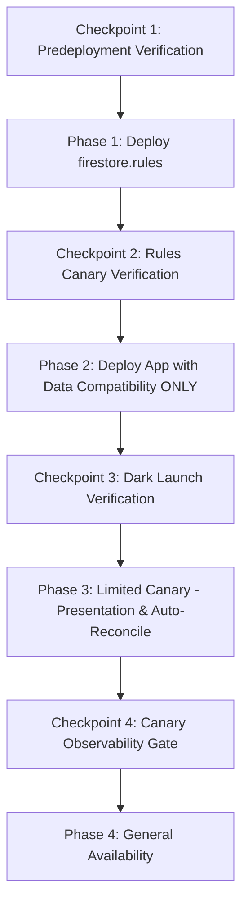

# AniHub F01 — Production Rollout, Capability Management & Safe Rollback Runbook

> **DOCUMENT STATUS:** Operational Specification & Runbook Only.  
> **EXECUTION NOTICE:** Do NOT execute deployment commands during Phase G1.4C. Production activation is strictly prohibited until explicit stakeholder approval and completion of all predeployment gates.

---

## 1. Executive Summary & Architecture Overview

Phase F01 introduces Automatic and Manual Anime Grouping into AniHub. Because grouping introduces new subcollections (`groups`, `groupNameKeys`), denormalized document fields (`groupId`, `_groupingReconciliations`), and collection counters (`groupingState`), rollout and rollback must be handled with architectural rigor.

A naive feature flag that toggles all grouping logic on or off simultaneously causes **catastrophic data corruption on rollback**: legacy clients moving anime or deleting collections ignore group membership documents, orphan reservation keys, and desynchronize counters.

To prevent this, AniHub implements a **Three-Tier Capability Control System**:

| Capability Layer | Scope & Responsibilities | Rollback State |
| :--- | :--- | :--- |
| **A. Data Compatibility** | Grouping-aware moves, collection deletions, account deletions, singleton dissolutions, reservation consistency, counter maintenance. | **MUST REMAIN ACTIVE** whenever grouped data exists in Firestore. |
| **B. Grouping Presentation** | Group cards, group detail headers, manual group modals, "Organize Library" button, and grouped layout partitioning. | **Can be disabled independently.** When disabled, all anime render as standalone cards. |
| **C. Automatic Reconciliation** | Auto-group creation, sequel/prequel component expansion, background AniList relationship passes. | **Can be disabled independently.** Halts all new automated write operations. |

---

## 2. Predeployment Checklist

Before any production changes are scheduled, all items in this checklist must be verified:

- [ ] **Baseline Regression**: All existing 219 baseline tests pass cleanly.
- [ ] **Rollback Suite**: All 18 rollback & capability integration tests (`tests/rollbackAndCapabilityControls.emulator.test.jsx`) pass against the Firebase Emulator.
- [ ] **Performance Benchmarks**: Emulator reconciliation latency on 40+ item synthetic libraries is under 500 ms; idempotent pass takes < 50 ms with zero writes.
- [ ] **Code Hygiene**: Scoped ESLint passes with zero warnings or errors. Production build (`npm run build`) completes successfully.
- [ ] **Emulator Isolation**: Verified that `.env` and preview configurations cannot leak into production Firebase projects.
- [ ] **Stakeholder Sign-Off**: Lead Engineer, QA, and Product Owner sign-off obtained on rollback runbook.

---

## 3. Git Branch Divergence Review

### Current Branch State
- **Local `main`**: 5 local commits ahead of remote tracking branch.
- **Remote `origin/main`**: 2 commits ahead of the initial branch point (updating `README.md` live demo URLs).

### Audit Findings
- **4 Local Checkpoint Commits**: `freekit-prompt: freekit checkpoint ...` generated by automated evaluation runs.
- **1 Local Implementation Commit**: Local feature updates for grouping capabilities and tests.
- **2 Remote Commits**: Non-code documentation changes (`README.md` demo links).

### Reconciliation Protocol (To be executed before deployment, NOT in G1.4C)
1. Fetch remote tracking branch: `git fetch origin main`.
2. Inspect remote changes: `git log -p HEAD..origin/main` to confirm only `README.md` changes exist.
3. Rebase or merge cleanly without squashing architectural checkpoints until final release review:
   ```bash
   git rebase origin/main
   ```
4. Verify working directory cleanliness: `git status`.

---

## 4. Backup & Disaster Recovery Preparation

Before deploying new Firestore security rules or application bundles:

1. **Initiate Managed Firestore Export**:
   ```bash
   gcloud firestore export gs://<PROJECT_ID>-firestore-backups/pre-f01-rollout-$(date +%Y%m%d%H%M%S)
   ```
2. **Verify Backup Completion**:
   ```bash
   gcloud firestore operations list
   ```
3. **Capture Production Rules Snapshot**:
   Preserve `src/production-firestore-rules.txt` as the rollback target for Firestore security rules.

---

## 5. Production Compatibility & Rules-First Deployment

### Current Production Rules vs. Proposed Rules
- **Current Deployed Rules (`src/production-firestore-rules.txt`)**:
  - Only permit access to `/users/{uid}`, `/watchlist/{id}`, `/completed/{id}`, `/collections/{id}`, and `/items/{id}`.
  - Contain **no match blocks** for `/users/{uid}/groups/{groupId}` or `/users/{uid}/groupNameKeys/{reservationId}`.
- **Rules-First Requirement**:
  - Deploying the application client before rules deployment will cause **immediate Grpc 7 PERMISSION_DENIED errors** whenever any user attempts group creation or reconciliation.
  - **Rules MUST be deployed first.**

### Backward Compatibility Verification
- **Legacy Clients**: The proposed rules in `firestore.rules` maintain full backward compatibility:
  - Document create/update rules permit anime documents without `groupId` or `_groupingReconciliations`.
  - Collections without `groupingState` (counterless collections) can be created, updated, and deleted normally.
  - Account deletion for users without grouping metadata succeeds unconditionally under `isOwner(uid)`.

### Rules Deployment Command
```bash
firebase deploy --only firestore:rules --project <PRODUCTION_PROJECT_ID>
```

---

## 6. Phased Rollout Sequence



### Phase 1: Security Rules Deployment
1. Deploy `firestore.rules` to production.
2. Monitor production error logs for 60 minutes.
3. Confirm existing legacy users experience zero permission-denied errors during normal watchlist, completed, and collection activity.

### Phase 2: Application Compatibility Layer (Dark Launch)
1. Deploy application bundle with:
   - `Data Compatibility`: **ENABLED**
   - `Grouping Presentation`: **DISABLED**
   - `Automatic Reconciliation`: **DISABLED**
2. In this state:
   - Users interact with the normal, familiar AniHub UI.
   - Any background or migration operations will safely handle group relationships if encountered.
   - Zero UI changes or automatic reconciliation passes run.

### Phase 3: Limited Canary Cohort
1. **Production Activation Mechanism**:
   - Browser-local flags (such as `localStorage` or query params) are **NOT authorized security boundaries** and must not be used for production cohort activation.
   - Per-user activation must be controlled via server-side configuration, Firebase Remote Config with target user IDs, or custom user claims (`customClaims.canaryGrouping = true`).
   - If a server-managed rollout service is unavailable, activation must be gated by a secure backend feature-flags document in Firestore readable only by authenticated canary users.
2. Enable Presentation and Automatic Reconciliation for canary cohort (5% of active users).
3. Monitor performance, document writes, and user issue reports for 72 hours.

### Phase 4: Full Production Rollout
1. Promote feature flags to 100% of user base.
2. Verify system under peak traffic.

---

## 7. Monitoring, Telemetry & Warning Indicators

Monitor Google Cloud Monitoring and Firebase Console for the following indicators:

| Metric / Indicator | Normal Threshold | Warning Threshold | Critical (Rollback Trigger) |
| :--- | :--- | :--- | :--- |
| **Firestore Permission Denied** | < 0.01% of requests | > 0.1% of requests | > 0.5% of requests |
| **Reconciliation Duration** | < 500 ms per scope | > 1,500 ms per scope | > 3,000 ms or query timeouts |
| **Orphaned Reservation Rate** | 0 per day | > 5 per day | > 20 per day |
| **Collection Counter Drift** | 0 discrepancies | Any detected drift | Repeated desyncs |
| **Client Error Spikes** | < 0.05% unhandled | > 0.5% unhandled | > 1.0% unhandled |

---

## 8. Emergency Rollback Procedure

If a critical issue is detected during Phase 3 or Phase 4:

### Step 1: Disable Automatic Reconciliation Immediately
- Action: Toggle `automaticReconciliation: false` in remote configuration.
- Effect: Stops all automated group creations, expansions, and background AniList passes.
- Data Impact: Zero write amplification; existing groups remain completely intact.

### Step 2: Disable Grouping Presentation
- Action: Toggle `presentation: false` in remote configuration.
- Effect: UI reverts to showing all anime as standalone cards. Manual group controls are hidden.
- User Experience: Users see all their anime without disruption. Groupings are preserved in the database.

### Step 3: PRESERVE Data Compatibility Layer
- **CRITICAL DIRECTIVE**: **DO NOT DISABLE DATA COMPATIBILITY.**
- Rationale: If a user moves an anime that previously had a `groupId`, or deletes a collection that has groups, the data-compatibility layer ensures:
  1. The `groupId` is cleared cleanly.
  2. The group document is dissolved if only 1 member remains.
  3. The collection counter is decremented accurately.
  4. The name reservation key is deleted.
- Disabling data compatibility would corrupt user collections and leave orphaned Firestore documents.

### Step 4: Post-Rollback Integrity Verification
Run the verification script to confirm zero data corruption across user scopes:
1. Confirm all groups in Firestore have `>= 2` members or are scheduled for cleanup.
2. Confirm each `groupNameKeys` document matches an active group.
3. Confirm collection `groupCount` equals the actual number of active groups in that collection.
4. Confirm no anime document contains a dangling `groupId` referencing a non-existent group.

---

## 9. Conditions Requiring Immediate Rollout Abort

The rollout **MUST BE STOPPED IMMEDIATELY** and the emergency rollback initiated if any of the following occur:

1. **Permission Denied Spikes**: Any sustained increase in `permission-denied` errors on core user operations (Watchlist, Completed, Collection items).
2. **Data Loss Incident**: Any report or log showing an anime document being lost or deleted during movement or grouping.
3. **Account Deletion Failure**: Any failure during account deletion that leaves orphaned user data in `groups` or `groupNameKeys`.
4. **Infinite Reconciliation Loop**: Continuous background write operations observed on the same scope without user-driven library changes.
5. **Quota Exhaustion**: Unexpected surge in Firestore read/write billing operations exceeding budget alerts.

---

## 10. Approval Checkpoints

| Checkpoint Gate | Description | Responsible Party | Sign-Off Status |
| :--- | :--- | :--- | :--- |
| **Gate 1: Pre-Deployment** | 219 baseline tests + 18 rollback emulator tests pass; build succeeds. | QA / Lead Developer | [ ] APPROVED |
| **Gate 2: Rules Deployment** | Firestore security rules deployed and verified with zero legacy impact. | Cloud Architect / Lead | [ ] APPROVED |
| **Gate 3: Dark Launch** | Application deployed with Data Compatibility only. | Engineering Manager | [ ] APPROVED |
| **Gate 4: Canary Launch** | 5% canary cohort active with monitoring green for 72 hours. | Product & Operations | [ ] APPROVED |
| **Gate 5: Full Rollout** | 100% activation across all production users. | VP Engineering / Product | [ ] APPROVED |
