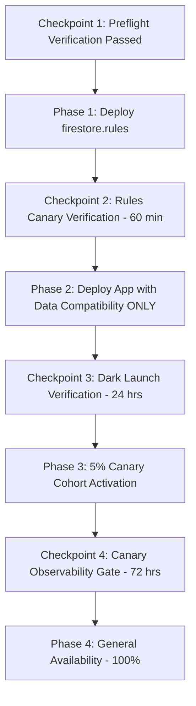

# AniHub F01 — Production Rollout, Capability Management & Safe Rollback Runbook

> **DOCUMENT STATUS:** Operational Specification & Preflight Runbook Only (Phase G1.5 Refined).  
> **EXECUTION NOTICE:** Do NOT execute production deployment commands during this preflight phase. Production activation is strictly prohibited until explicit stakeholder sign-off and completion of all predeployment gates.

---

## 1. Executive Summary & Architecture Overview

Phase F01 introduces Automatic and Manual Anime Grouping into AniHub. Because grouping introduces new subcollections (`groups`, `groupNameKeys`), denormalized document fields (`groupId`, `_groupingReconciliations`), and collection counters (`groupingState`), rollout and rollback must be handled with architectural rigor.

A naive feature flag that toggles all grouping logic on or off simultaneously causes **catastrophic data corruption on rollback**: legacy clients moving anime or deleting collections ignore group membership documents, orphan reservation keys, and desynchronize counters.

To prevent this, AniHub implements a **Three-Tier Capability Control System**:

| Capability Layer | Scope & Responsibilities | Rollback State |
| :--- | :--- | :--- |
| **A. Data Compatibility** | Grouping-aware moves, collection deletions, account deletions, singleton dissolutions, reservation consistency, counter maintenance. | **MUST REMAIN ACTIVE** whenever grouped data exists in Firestore. |
| **B. Grouping Presentation** | Group cards, group detail headers, manual group modals, "Organize Library" button, and grouped layout partitioning. | **Can be disabled independently.** When disabled, all anime render as standalone cards. |
| **C. Automatic Reconciliation** | Auto-group creation, sequel/prequel component expansion, background AniList relationship passes. | **Can be disabled independently.** Halts all new automated write operations. |

---

## 2. Predeployment Checklist: Local Automated vs. Production Manual

### A. Tasks Verified Locally via Automated Emulators (COMPLETED)
- [x] **Baseline Unit & Integration**: 170 Vitest unit/integration tests passing cleanly.
- [x] **Node Test Runner Baseline**: 20 tests in `groupingUtils`, `groupingPreviewConfig`, and `anilistRelations` passing cleanly.
- [x] **Firestore Security Rules Emulator Suite**: 21 emulator tests in `tests/groupingFirestore.emulator.test.js` passing under proposed rules.
- [x] **Account Deletion Suite**: 7 emulator tests in `tests/accountDeletion.emulator.test.jsx` passing.
- [x] **Automatic Save Flow Suite**: 1 emulator test in `tests/automaticSaveFlow.emulator.test.jsx` passing.
- [x] **Rollback Lifecycle Suite**: All 18 rollback & capability integration tests (`tests/rollbackAndCapabilityControls.emulator.test.jsx`) passing on live emulators.
- [x] **Production Activation & Preflight Suite**: All 12 preflight tests (`tests/productionActivation.emulator.test.jsx`) passing on live emulators.
- [x] **Performance Benchmarks**: Verified on synthetic libraries (`tests/groupingPerformance.emulator.test.jsx`):
  - Initial reconciliation (40 items, 10 groups): **~350–500 ms**
  - Idempotent no-op pass (40 items, 0 writes): **< 10 ms** (zero unnecessary writes)
  - Grouping-aware move: **< 250 ms**
  - Collection deletion: **< 60 ms**
  - Account deletion: **< 800 ms**
- [x] **Code Quality & Build**: Scoped ESLint passes with 0 errors/warnings; production build (`vite build`) completes in ~1.4s.
- [x] **Preview Isolation**: Strict isolation enforced by `groupingPreviewConfig.js` (rejects production project IDs, requires loopback emulators).

### B. Actions Requiring Authorized Production Access (PENDING RELEASE WINDOW)
- [ ] **Git Rebase Sign-Off**: Reconcile local 5 commits with remote tracking branch (see Section 3).
- [ ] **Firestore Managed Export**: Initiate Google Cloud Storage export before rules change.
- [ ] **Rules-First Deployment**: Deploy `firestore.rules` via Firebase CLI with production credentials.
- [ ] **Remote Config Configuration**: Create grouping parameters in Firebase Remote Config Console (see Section 6).
- [ ] **Application Deployment**: Deploy client bundle with production defaults (presentation: false, autoReconcile: false).

---

## 3. Git Branch Divergence Review

### Current Branch State
- **Local `main`**: 5 local commits ahead of remote tracking branch.
- **Remote `origin/main`**: 2 commits ahead of the initial branch point (updating `README.md` live demo URLs).

### Audit Findings
- **4 Local Checkpoint Commits**: `freekit-prompt: freekit checkpoint ...` generated by automated evaluation runs.
- **1 Local Implementation Commit**: Local feature updates for grouping capabilities and tests.
- **2 Remote Commits**: Non-code documentation changes (`README.md` demo links).
- **Working Copy State**:
  - Uncommitted modifications: Core capability controls, security rules, and test suites.
  - Untracked files: `docs/ANIHUB_F01_PRODUCTION_ROLLOUT.md`, `src/firebase/productionActivation.js`, `src/firebase/anilistRelations.js`, benchmark & preflight test suites.

### Recommended Synchronization Protocol (DO NOT EXECUTE UNTIL PR STAGE)
1. Ensure working directory is clean or commit preflight changes locally to a dedicated feature branch:
   ```bash
   git checkout -b feat/f01-grouping-production-readiness
   git add docs/ src/ tests/ firestore.rules
   git commit -m "feat(f01): complete production activation, capability controls, and preflight tests"
   ```
2. Fetch remote changes without modifying working tree:
   ```bash
   git fetch origin main
   ```
3. Rebase feature branch on top of updated `origin/main`:
   ```bash
   git rebase origin/main
   ```
4. Verify tests pass after rebase:
   ```bash
   npm test
   ```

---

## 4. Backup & Disaster Recovery Preparation

Before deploying new Firestore security rules or application bundles:

1. **Initiate Managed Firestore Export**:
   ```bash
   gcloud firestore export gs://<PROJECT_ID>-firestore-backups/pre-f01-rollout-$(date +%Y%m%d%H%M%S) --project=<PROJECT_ID>
   ```
2. **Verify Backup Completion**:
   ```bash
   gcloud firestore operations list --project=<PROJECT_ID>
   ```
3. **Preserve Production Rules Snapshot**:
   `src/production-firestore-rules.txt` is preserved in the repository as the immediate rollback target for security rules.

---

## 5. Production Compatibility & Rules-First Deployment

### Current Production Rules vs. Proposed Rules
- **Current Deployed Rules (`src/production-firestore-rules.txt`)**:
  - Only permit access to `/users/{uid}`, `/watchlist/{id}`, `/completed/{id}`, `/collections/{id}`, and `/items/{id}`.
  - Contain **no match blocks** for `/users/{uid}/groups/{groupId}` or `/users/{uid}/groupNameKeys/{reservationId}`.
- **Rules-First Requirement**:
  - Deploying the application client before rules deployment will cause **immediate Grpc 7 PERMISSION_DENIED errors** whenever any user attempts group creation or reconciliation.
  - **Rules MUST be deployed first.**

### Backward Compatibility Verification
- **Legacy Clients**: The proposed rules in `firestore.rules` maintain full backward compatibility:
  - Document create/update rules permit anime documents without `groupId` or `_groupingReconciliations`.
  - Collections without `groupingState` (counterless collections) can be created, updated, and deleted normally.
  - Account deletion for users without grouping metadata succeeds unconditionally under `isOwner(uid)`.

### Rules Deployment Command
```bash
firebase deploy --only firestore:rules --project <PRODUCTION_PROJECT_ID>
```

---

## 6. Production Activation Configuration & Canary Rollout

### Selected Architecture: Server-Managed Remote Config with Deterministic Hashing
- **Fail-Closed Guarantee**: If Remote Config cannot be reached or returns an error, the application automatically falls back to:
  - `dataCompatibility: true` (ensuring safe cleanup is never disabled)
  - `presentation: false` (hiding grouping UI)
  - `autoReconciliation: false` (blocking automated writes)
- **Deterministic Cohort Hashing**: Rollout percentage uses `hashUidToPercent(uid)` (32-bit FNV-1a variant), ensuring consistent per-user experience across sessions without fragile client-side `localStorage`.

### Firebase Remote Config Parameters Schema
Configure the following parameters in the Firebase Console (or via Remote Config REST API):

| Parameter Key | Data Type | Default Value | Canary Value | Description |
| :--- | :---: | :---: | :---: | :--- |
| `grouping_data_compatibility` | Boolean | `true` | `true` | Safety layer for moves and deletions. Always true. |
| `grouping_presentation_enabled` | Boolean | `false` | `true` (for canary) | Controls group cards, detail views, and manual grouping UI. |
| `grouping_auto_reconcile_enabled`| Boolean | `false` | `true` (for canary) | Controls automated group creation & background passes. |
| `grouping_canary_percentage` | Number | `0` | `5` | Percentage of users (0–100) receiving canary activation. |
| `grouping_canary_uids` | JSON String | `[]` | `["<TESTER_UID_1>", ...]` | Explicit allowlist of internal tester UIDs. |
| `grouping_emergency_stop` | Boolean | `false` | `false` | Global circuit breaker; immediately disables presentation & auto-reconcile. |

### Phased Rollout Sequence



---

## 7. Monitoring, Telemetry & Warning Indicators

Monitor Google Cloud Monitoring and Firebase Console for the following indicators:

| Metric / Indicator | Normal Threshold | Warning Threshold | Critical (Rollback Trigger) |
| :--- | :--- | :--- | :--- |
| **Firestore Permission Denied** | < 0.01% of requests | > 0.1% of requests | > 0.5% of requests |
| **Reconciliation Duration** | < 500 ms per scope | > 1,500 ms per scope | > 3,000 ms or query timeouts |
| **Orphaned Reservation Rate** | 0 per day | > 5 per day | > 20 per day |
| **Collection Counter Drift** | 0 discrepancies | Any detected drift | Repeated desyncs |
| **Client Error Spikes** | < 0.05% unhandled | > 0.5% unhandled | > 1.0% unhandled |

---

## 8. Emergency Rollback Procedure

If a critical issue is detected during Phase 3 or Phase 4:

### Step 1: Trigger Emergency Stop in Remote Config
- Action: Update `grouping_emergency_stop: true` in Firebase Remote Config and publish.
- Effect: Clients immediately fall back to `presentation: false`, `autoReconciliation: false`.
- Write Impact: Automated background passes stop instantly; zero write amplification.

### Step 2: PRESERVE Data Compatibility Layer
- **CRITICAL DIRECTIVE**: **DO NOT SET `grouping_data_compatibility: false`.**
- Rationale: If a user moves an anime that previously had a `groupId`, or deletes a collection that has groups, the data-compatibility layer ensures:
  1. The `groupId` is cleared cleanly.
  2. The group document is dissolved if only 1 member remains.
  3. The collection counter is decremented accurately.
  4. The name reservation key is deleted.
- Disabling data compatibility would corrupt user collections and leave orphaned Firestore documents.

### Step 3: Outdated Browser Tab Protection
- Verified by Emulator Test 10: In-flight operations from browser tabs that have not yet refreshed Remote Config continue to use the data-compatibility service paths. No unhandled exceptions or orphan reservation keys will be generated.

### Step 4: Post-Rollback Integrity Verification
Run the verification query to confirm zero data corruption across user scopes:
1. Confirm all groups in Firestore have `>= 2` members or are scheduled for cleanup.
2. Confirm each `groupNameKeys` document matches an active group.
3. Confirm collection `groupCount` equals the actual number of active groups in that collection.
4. Confirm no anime document contains a dangling `groupId` referencing a non-existent group.

---

## 9. Conditions Requiring Immediate Rollout Abort

The rollout **MUST BE STOPPED IMMEDIATELY** and the emergency rollback initiated if any of the following occur:

1. **Permission Denied Spikes**: Any sustained increase in `permission-denied` errors on core user operations (Watchlist, Completed, Collection items).
2. **Data Loss Incident**: Any report or log showing an anime document being lost or deleted during movement or grouping.
3. **Account Deletion Failure**: Any failure during account deletion that leaves orphaned user data in `groups` or `groupNameKeys`.
4. **Infinite Reconciliation Loop**: Continuous background write operations observed on the same scope without user-driven library changes.
5. **Quota Exhaustion**: Unexpected surge in Firestore read/write billing operations exceeding budget alerts.

---

## 10. Approval Checkpoints

| Checkpoint Gate | Description | Responsible Party | Sign-Off Status |
| :--- | :--- | :--- | :--- |
| **Gate 1: Pre-Deployment** | 250 automated tests pass; ESLint clean; build succeeds. | QA / Lead Developer | [x] READY |
| **Gate 2: Rules Deployment** | Firestore security rules deployed and verified with zero legacy impact. | Cloud Architect / Lead | [ ] PENDING |
| **Gate 3: Dark Launch** | Application deployed with Data Compatibility only. | Engineering Manager | [ ] PENDING |
| **Gate 4: Canary Launch** | 5% canary cohort active with monitoring green for 72 hours. | Product & Operations | [ ] PENDING |
| **Gate 5: Full Rollout** | 100% activation across all production users. | VP Engineering / Product | [ ] PENDING |
